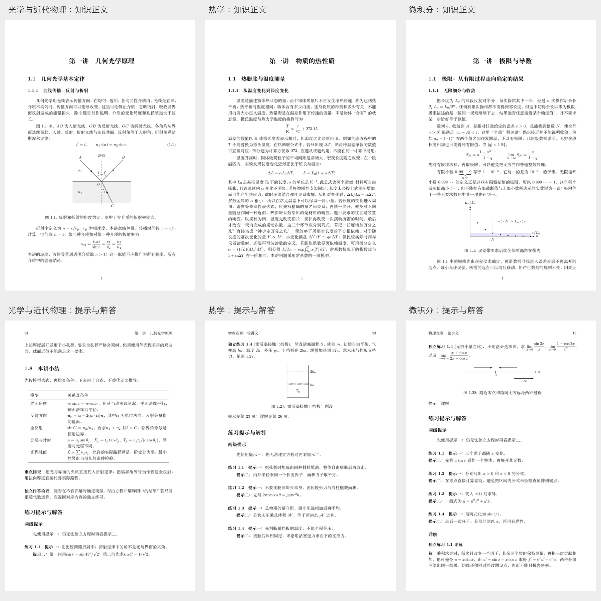

# 已完成讲义比较与完善记录

当前整套已扩展为25讲并统一知识编排。以下容量比较保留此前检查范围；当前共同结构及各讲统计见[知识编排结构核对](知识讲解结构检查.md)。

当前21讲的整套目录与核对见[全套讲义核对](../全套讲义核对.md)。以下保留2026年10月24日阶段的比较数据。

核查日期：2026年10月24日。范围为光学与近代物理7讲、热学4讲、微积分4讲，共15讲。

**本轮已完成知识正文扩展、短解答补充、概念图增加及统一排版。微积分知识小节的讲解文字中位数由160字增至360字，热学为394字，光学与近代物理为311字；三部分的讲解密度比完善前接近。专题范围仍有差异，各讲篇幅不机械拉齐。**

## 完善的内容

微积分四讲把公式前后的理由写入连续正文：补出误差与极限、链式法则、运动方向、微元选取、变限积分、换元边界、质心、势能判稳、泰勒余项、曲率、平衡解、时间尺度、流入动量、干摩擦及追逐模型的推导和条件。第四讲将转动、质心与追逐分别展开，减少多个模型挤在同一小点中的情况。

光学与近代物理重点扩展了近轴误差、视深与符号、辅助光线、两界面到薄透镜、主平面与矩阵、观察位置与角放大率、相干与可见度、薄膜相位、光栅缺级、截止电压、事件测量条件、约化质量和反冲。热学补充了绝热条件、状态图坐标含义、过程热容、弹簧预紧和接触切换、相变能量及蒸气分压的判断。

新增21幅知识讲解TikZ图，其中微积分19幅、光学与近代物理2幅；全套604幅图。对23处较短解答补入建模依据、中间代数、方向或量纲检查，保留已有题目、模型与图号标签。概念、推导、条件与模型分析融入正文。

## 完善前后比较

以下“知识小节”以正文小节为单位；中位数按全部小节合并计算。

| 部分 | 每讲平均知识汉字：前→现 | 知识小节汉字中位数：前→现 | 当前小节数 | 当前少于200字的小节 | TikZ图数：前→现 |
|---|---:|---:|---:|---:|---:|
| 光学与近代物理 | 2,792→3,612 | 225→311 | 73 | 0/73 | 333→335 |
| 热学 | 4,408.8→4,782 | 389→394 | 43 | 0/43 | 126→126 |
| 微积分 | 1,530→3,021.5 | 160→360 | 33 | 1/33 | 124→143 |

200字仅为观察短小节的统计分界。剩余较短小节承接前文的运动分解，不以补字数代替推导。字符数不能单独证明知识完整、难度相当或解答充分。

## 当前逐讲篇幅

| 部分 | 讲次与讲名 | PDF页数 | 正文排印字符 | 知识讲解汉字 | 解答段汉字中位数 | 图数 |
|---|---|---:|---:|---:|---:|---:|
| 光学与近代物理 | 01 几何光学原理 | 39 | 18,589 | 3,186 | 287 | 51 |
| 光学与近代物理 | 02 球面反射与折射 | 33 | 15,315 | 4,120 | 189.5 | 40 |
| 光学与近代物理 | 03 薄透镜与光学系统 | 29 | 12,941 | 2,497 | 192.5 | 36 |
| 光学与近代物理 | 04 光学仪器与综合成像 | 31 | 14,351 | 2,531 | 197 | 38 |
| 光学与近代物理 | 05 波动光学与光电效应 | 52 | 24,187 | 6,173 | 125 | 78 |
| 光学与近代物理 | 06 相对论基础 | 47 | 22,587 | 4,207 | 206 | 59 |
| 光学与近代物理 | 07 物质波与原子模型 | 27 | 13,273 | 2,570 | 161.5 | 33 |
| 热学 | 01 物质的热性质 | 28 | 14,363 | 4,293 | 235 | 31 |
| 热学 | 02 理想气体的内能 | 28 | 14,830 | 4,538 | 205.5 | 32 |
| 热学 | 03 热力学过程与循环 | 28 | 15,178 | 4,873 | 215 | 31 |
| 热学 | 04 相变与饱和蒸汽 | 29 | 16,765 | 5,424 | 246 | 32 |
| 微积分 | 01 极限与导数 | 23 | 11,430 | 2,733 | 137.5 | 32 |
| 微积分 | 02 积分与连续分布 | 26 | 12,798 | 3,094 | 158 | 37 |
| 微积分 | 03 极值、近似与曲线几何 | 23 | 12,160 | 2,954 | 137 | 30 |
| 微积分 | 04 微分方程与物理应用 | 31 | 16,528 | 3,305 | 170.5 | 44 |

光学与近代物理的波动光学、光电效应和相对论覆盖范围较广，仍明显长于其他讲；内部以物理内容分节，保留既定讲次。热学四讲篇幅接近；微积分第四讲因物理应用较多而较长。三部分现在使用相同的教学表达和版式规则，阅读负荷仍随模型复杂度变化。

## 统一的排版与图文规则

15个工程的统一样式副本逐字节一致。纸张176×250mm，11pt Fandol正文，行距1.18，段距3pt，首行缩进2字；封面、页眉、标题与图题保持一致。删除局部图文间距覆盖，把解答开头、标题空间预留和长解答连续跨页的规则收进共同样式。

“练习提示与解答”统一为不编号的节，两级提示分段排列；小结保持同一形式。需要在后文反复引用的基础关系编号，其余局部推导使用无编号公式。目录后直接进入知识正文。调整小结、详解标题与尾部解答图的位置，避免标题独留页尾和末页只剩一张解答图。

所有题目保留题设图及解答过程图；解答明确使用图号和图中方向、位置、路径、区域或状态关系。知识讲解图用来说明概念和推导，不承担题设图的作用。全套页面已渲染检查，新增概念图逐幅复核；未发现空白正文页、未定义引用、缺字或公式越界警告。自然结束的最后一页允许留有余白。

## 统计口径与文件

正文排印字符取最终PDF正文页，剔除封面、目录、页眉页脚及空白；汉字、标点、字母、数字、公式符号和图内文字均计入。页数含封面与目录。知识讲解汉字剔除标题、题目、解答、提示、小结、图题及绘图代码；公式中的少量中文注释仍计入。知识小节包含其下属更小标题的正文，上级引入段只计入整讲知识文字。解答段剔除图及标题，分解模型可能独立成段，解答段数不直接等于题数。

[各讲字符统计.csv](各讲字符统计.csv)记录15讲的当前数据；[知识小节字符统计.csv](知识小节字符统计.csv)记录149个小节；[完善前后对照.csv](完善前后对照.csv)保留同口径的前后数据。[交付检查.json](交付检查.json)记录当前PDF、图数、样式一致性及标签保留检查。所有讲义沿用既定文件名，TikZ代码随各讲TeX工程交付。
